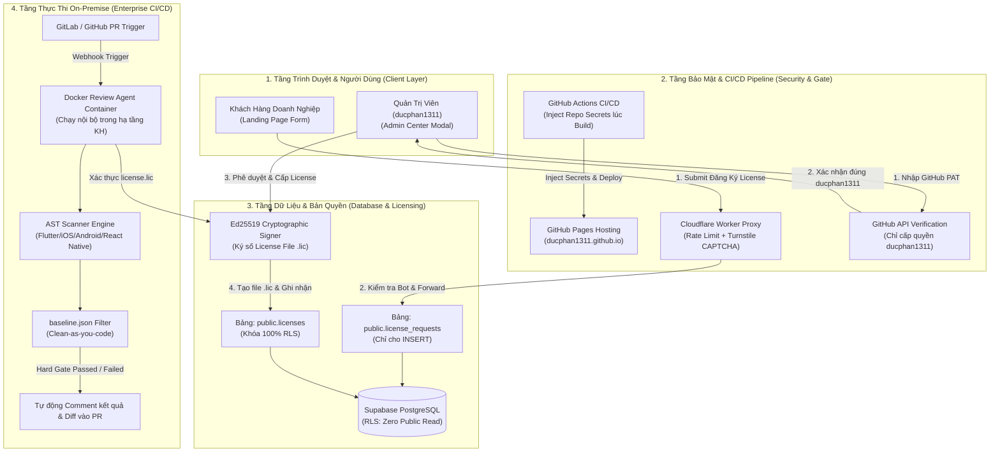

# 🛡️ AI Review Engine — Enterprise Platform Portal

> **Hệ Thống Tự Động Kiểm Soát Kiến Trúc & Chất Lượng Mã Nguồn Toàn Diện Cho Doanh Nghiệp (Mobile-First On-Premise)**

---

## 📌 1. Tổng Quan Kiến Trúc & Triết Lý Hệ Thống

AI Review Engine được xây dựng dựa trên nguyên lý **Zero Hallucination** và **100% On-Premise**, giải quyết triệt để vấn đề rò rỉ mã nguồn ra các dịch vụ AI Cloud công cộng:

1. **Hard Gate Tuyệt Đối (AST Static Analysis)**: Mọi quy tắc kiến trúc (Dependency Injection, phân tầng Clean Architecture, Memory Leaks, UI Blocking, Hardcoded Secrets) được kiểm soát bằng AST Scanner nội bộ. AST trả về vi phạm là chặn PR ngay lập tức, không có hiện tượng ảo giác (hallucination).
2. **AI Advisory (Cố vấn mềm)**: AI chỉ tham gia vào việc giải thích ngữ cảnh vi phạm, đề xuất code diff sửa lỗi tối ưu và hỗ trợ lập trình viên tái cấu trúc mã nguồn.
3. **Clean-As-You-Code (`baseline.json`)**: Hệ thống tính toán mã băm `SHA-256` trên từng lỗi cũ để bỏ qua các món nợ kỹ thuật lịch sử (legacy debt), chỉ bắt buộc kiểm tra và chặn các vi phạm mới phát sinh trên Git diff của Pull Request.
4. **Phân Quyền & Bảo Mật Đa Tầng**: Source code trên Git không chứa bất kỳ secret/key nào. Quá trình triển khai lên GitHub Pages được tự động inject thông qua **GitHub Actions CI/CD Secrets**.

---

## 🔄 2. Sơ Đồ Luồng Hoạt Động Toàn Dự Án (Architecture Flowchart)



---

## 🧭 3. Chi Tiết Các Luồng Đi Qua (Workflows)

### Luồng 1: Đăng ký & Tiếp nhận License Dùng Thử
1. Khách hàng truy cập `https://ducphan1311.github.io/ai-review-platform/` và điền form đăng ký doanh nghiệp.
2. Dữ liệu được gửi an toàn về Supabase.
3. **Bảo mật cơ sở dữ liệu (RLS)**: Bảng `public.license_requests` đã được cấu hình chính sách **Row Level Security (RLS)** nghiêm ngặt:
   - ✅ **Public INSERT**: Cho phép khách hàng gửi form.
   - ⛔ **Public SELECT**: Bị vô hiệu hóa hoàn toàn. Dù kẻ xấu có lấy được `anon key` cũng không thể đọc trộm danh sách thông tin khách hàng.

### Luồng 2: Cổng Quản Trị & Cấp Phép Bản Quyền (Admin Center)
1. Chỉ tài khoản GitHub `ducphan1311` mới có quyền truy cập.
2. Cổng quản trị yêu cầu nhập GitHub Personal Access Token (PAT):
   - Hệ thống gọi `https://api.github.com/user` để định danh chính chủ.
   - Nếu không phải `ducphan1311`, hệ thống lập tức từ chối quyền truy cập (`Access Denied`).
3. Khi được phê duyệt, admin thực hiện cấu hình thời hạn dùng (30 ngày, 90 ngày, 365 ngày), số lượng repository và sinh file bản quyền số `license_<customer>.lic`.

### Luồng 3: Bảo Vệ Secret Tuyệt Đối Qua CI/CD
1. Mã nguồn trên Git **không chứa chuỗi URL hay API Key thật**:
   - Trong file `index.html` chỉ sử dụng các placeholder: `__SUPABASE_URL_PLACEHOLDER__` và `__SUPABASE_ANON_KEY_PLACEHOLDER__`.
2. Khóa bảo mật được lưu trữ tại **GitHub Repository Secrets** (`SUPABASE_URL`, `SUPABASE_ANON_KEY`).
3. Workflow GitHub Actions (`.github/workflows/deploy.yml`) sẽ tự động inject các giá trị bí mật này vào bản build tĩnh trước khi đẩy lên GitHub Pages.

### Luồng 4: Tùy Chọn Cloudflare Worker Proxy (Tối Đa Hóa Bảo Mật)
- Thư mục `cloudflare-worker/` cung cấp sẵn mã nguồn proxy trung gian:
  - Chặn bot bằng **Cloudflare Turnstile CAPTCHA**.
  - Ẩn hoàn toàn Supabase URL và Database Key khỏi trình duyệt người dùng.
  - Rate-limit IP gửi form nhằm ngăn chặn nguy cơ spam rác database.

---

## 📂 4. Cấu Trúc Mã Nguồn

```text
platform-portal/
├── .github/
│   └── workflows/
│       └── deploy.yml              # CI/CD tự động inject secrets và deploy GitHub Pages
├── assets/
│   └── images/                     # Ảnh minh họa thực tế PR Review & Demo Engine
├── cloudflare-worker/
│   ├── worker.js                   # Proxy trung gian bảo vệ Supabase & tích hợp CAPTCHA
│   └── wrangler.toml               # Cấu hình triển khai Cloudflare Worker
├── docs/
│   ├── meta-variables.html         # Tài liệu: Các biến môi trường và Meta-Variables
│   ├── rule-authoring.html         # Tài liệu: Hướng dẫn viết Rule kiểm tra kiến trúc
│   └── setup-guide.html            # Tài liệu: Hướng dẫn tích hợp On-Premise Docker & CI/CD
├── index.html                      # Trang Landing Page Portal song ngữ (VI/EN) & Admin Modal
├── supabase_schema.sql             # SQL Script tạo bảng dữ liệu và cấu hình RLS Database
└── README.md                       # Tài liệu tổng quan kiến trúc hệ thống
```

---

## 🚀 5. Hướng Dẫn Vận Hành & Khởi Chạy Local

### Chạy Preview Local:
```bash
# Khởi động web server tĩnh tại cổng 3456
python3 -m http.server 3456
```
Mở trình duyệt tại: `http://localhost:3456`

### Cập Nhật & Deploy Lên Production:
Mọi commit được push lên nhánh `main` sẽ kích hoạt GitHub Actions workflow để tự động inject secrets và xuất bản lên GitHub Pages:
```bash
git add .
git commit -m "feat: your feature description"
git push origin main
```
Địa chỉ website chính thức: **[https://ducphan1311.github.io/ai-review-platform/](https://ducphan1311.github.io/ai-review-platform/)**
